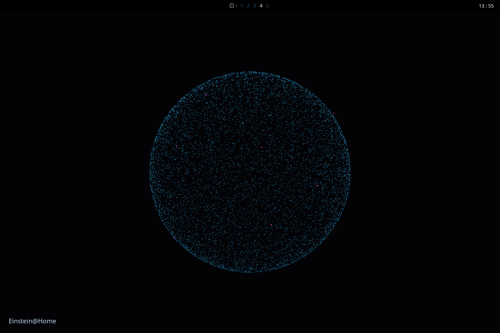

# einstein-home-vizz

Einsten@Home dropped the visualization when performing calculations, so we do our own.

We also want to download the raw data so we know what calc is currently going on.

TD: Ideally, some kind of a info in the UI should show us the job status, name etc.

